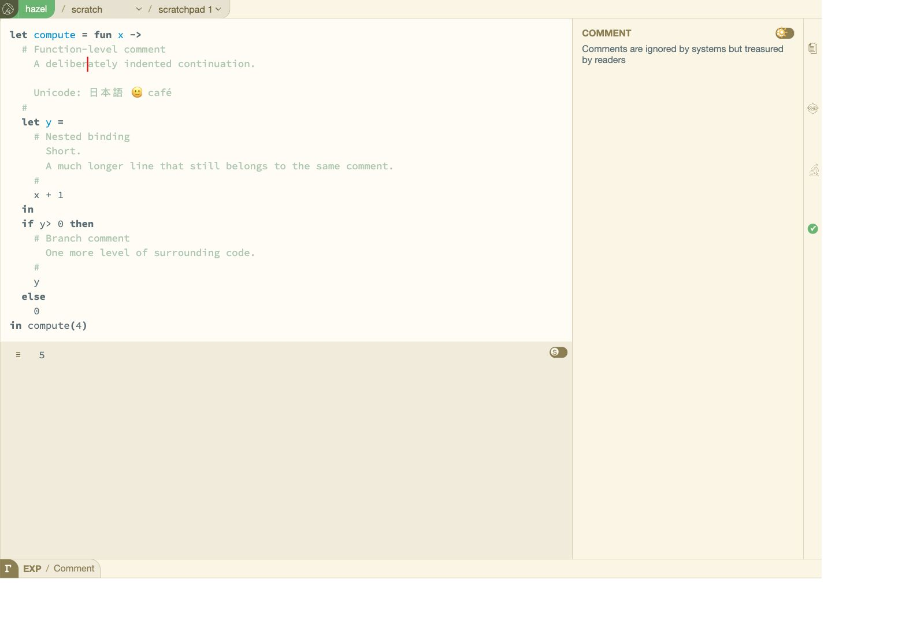
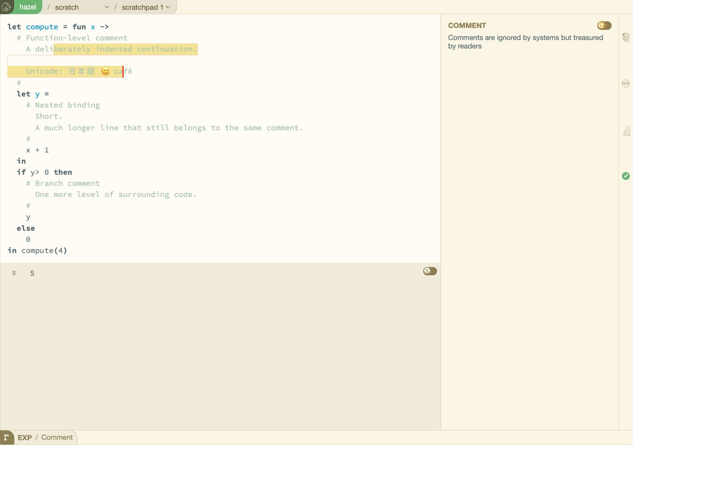
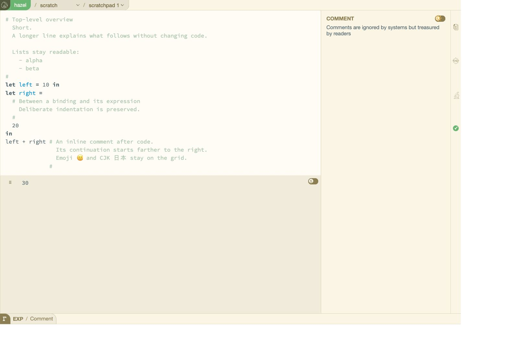
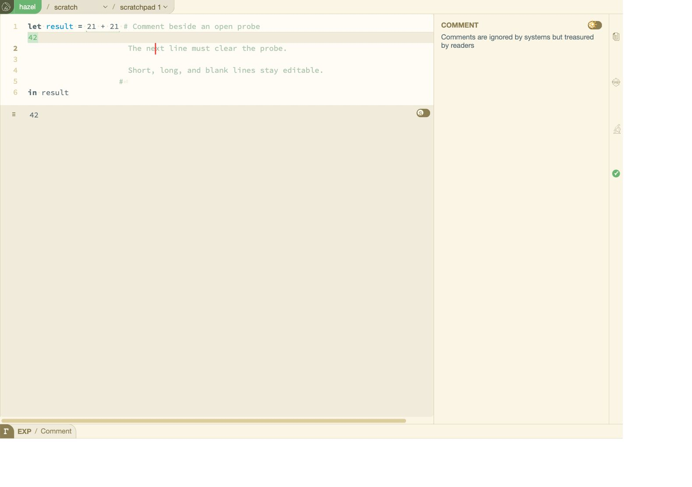
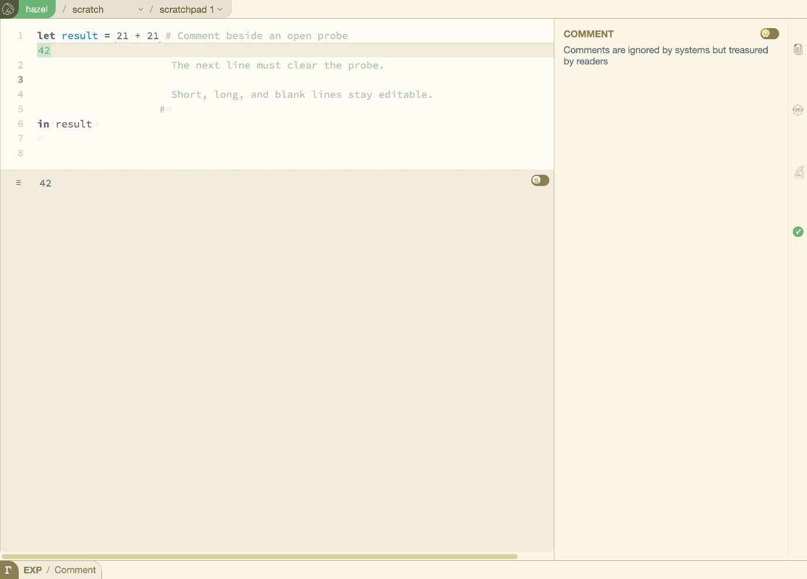

# Multiline comments — implementation and QA

Local branch: `codex/multiline-comments`.
Base: `e12145c69b5731aaa2cbd1b5d4d83820c4e1b4a3` (local `origin/dev`, October 9, 2026).
The base was verified against current `dev` through GitHub on October 17, 2026; the commits are identical.

## Behavior

The existing `# … #` comment syntax now accepts embedded newlines. A block remains a single secondary piece. Enter continues at the opening comment's column on the first line, and copies the preceding line's leading spaces on later lines. Paste preserves supplied indentation. Existing indent/dedent actions operate on physical comment lines, including selections crossing between code and comments. Backspace joins an automatically indented continuation in one action when indentation UX is enabled. Home/End stop at internal linebreaks; arrow movement, point targeting, selection anchors and highlights use the same multiline coordinate mapping. Cmd+/ from inside a block unwraps the block. Selecting several lines and typing `#` wraps them in a single block; the existing line-comment toggle still produces separate comments per code line.

The text parser, fast paste parser and editor agree about multiline comments. CRLF paste falls back to the typing parser and normalizes to LF. A newline after the closing `#` is a separate whitespace piece. Comment contents are not reflowed by this feature. Embedded `#` delimiters and nested comments are not introduced.

## Automated checks

- Development build: `opam exec --switch=editor-output -- dune build src test/haz3ltest.bc.js --profile dev` — passed.
- Multiline-comment suite: 28 cases covering the core implementation and browser-discovered regressions.
- Final regression run: `IDB_STUB="$PWD/test/idb_stub.js" test/run_node.sh test 'MultilineComments|Editing|Move|Unicode|Caret|FastParse|Undo|ProblemCollection|PersistentZipper' -q` — passed, 910 tests, 33.684 seconds.
- `git diff --check` — passed.
- Strict release typecheck: `opam exec --switch=editor-output -- dune build @check --profile release` — passed.

Coverage includes blank lines, uneven indentation, CJK and emoji widths, cursor movement and point targeting on continuation lines, clipping partial selections across and within rows, deletion, wrapping, comment toggling, indent/dedent and selection preservation, Enter/Backspace, CRLF paste, lexer diagnostic positions, and rows reserved for open projectors/refractors.

## Browser verification

Completed in the in-app browser against the locally compiled build served at `http://127.0.0.1:8891/`, in an isolated scratch buffer. A versioned script URL was used after rebuilding because an ordinary reload retained the older JavaScript bundle.

Browser testing and a follow-up user report found and fixed three additional issues:

1. Clipboard preprocessing removed every line's leading whitespace before parsing. It now distinguishes code indentation from comment content, including text pasted inside an existing comment. The same distinction is used for slide-source ingestion, agent code insertion, and clipboard-cache comparisons. Hashes inside quoted strings and labels do not open comments.
2. Clicking after a partial selection inside a nested comment could raise `Invalid_argument("Grapheme.split_nth")`. Clearing the selection could leave the character offset attached to a neighboring token. Comment identity is now restored along with the inner caret, as it already was for tile shards. A test reproduced the exception before the fix; both the regression test and the browser sequence pass afterward.
3. Clicking far to the right of a blank or short continuation line could raise the same exception, even without a selection. This was reproduced on the current build after the user reported it on the default scratch slide. The point-targeting row-boundary check performed a structural move while retaining an inner offset from the old token. It now uses the same caret step as the point search. A failing-before/passing-after regression covers blank, short, and Unicode lines with zero, one, and two reserved probe rows. The original browser click sequence also passes after the fix.

| Browser check | Observed result |
| --- | --- |
| Type an indented comment; repeated Enter and blank lines | Continuations retain indentation; the closing delimiter remains editable. |
| Paste nested comments with short/long lines, CJK, emoji, and accents | Supplied comment whitespace is retained; nested sample evaluates to `5`. |
| Format the nested program | Comment contents and indentation remain intact while code spacing is formatted. |
| Drag across a continuation, a blank line, and Unicode | Highlight follows physical rows and clips to the selected character endpoints. |
| Delete the selection, then undo | Exact original text is restored. |
| Indent/dedent the partial selection, then click inside it | Selected rows change by two spaces; dedenting restores the text; the subsequent click no longer crashes. |
| Top-level, list-style, between-expression, and trailing inline comments | Layout remains distinct at each position; sample evaluates to `30`. |
| Expand a probe beside the first comment line | Continuation lines move below the probe drawer; line numbers and caret targeting agree. |
| Enter then Backspace below the expanded probe | Exact original text is restored. |
| Click far beyond blank/short comment rows, approaching from above and below | Caret lands at the clicked row's end without an exception, including with the probe drawer expanded. |
| Whitespace indicators and line numbers enabled | External whitespace markers and logical line numbers remain aligned. |

Clipboard input was exercised through Hazel's Paste menu. The browser automation's keyboard paste did not trigger reliably, so that shortcut is not claimed as a completed browser check. Home/End, CRLF, comment wrapping/toggling, mixed code/comment selection, and indentation-UX variants have automated coverage. Dark-theme and cross-browser testing were not performed. The full repository test suite was not run.

## Screenshots

These are direct browser captures of the compiled implementation, not mockups.

### Nested function, binding, and branch indentation

Different line lengths, deliberate indentation, blank lines, and Unicode within one program. The caret is inside a continuation line.

### Selection across a blank line and Unicode

The selection begins partway through one line and ends inside the Unicode line; intervening blank rows are preserved.

### Top-level and trailing inline positions

A top-level block contains list-style indentation, a second block sits between a binding and its expression, and a trailing inline block ends the editor contents.

### Expanded probe, whitespace indicators, and line numbers

The probe drawer occupies a visual row below the expression. Comment continuation text and its caret appear below that drawer, without overlap.

### Clicking beyond a blank continuation line

The click was at the far right of logical line 3. The caret lands at column zero of that blank comment line, below the expanded probe, and the editor remains usable. This is the sequence that previously raised `Grapheme.split_nth`.

